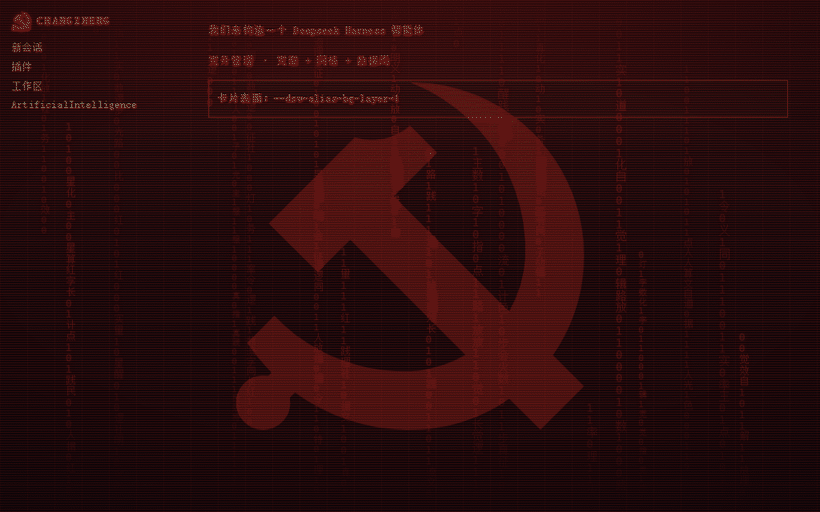
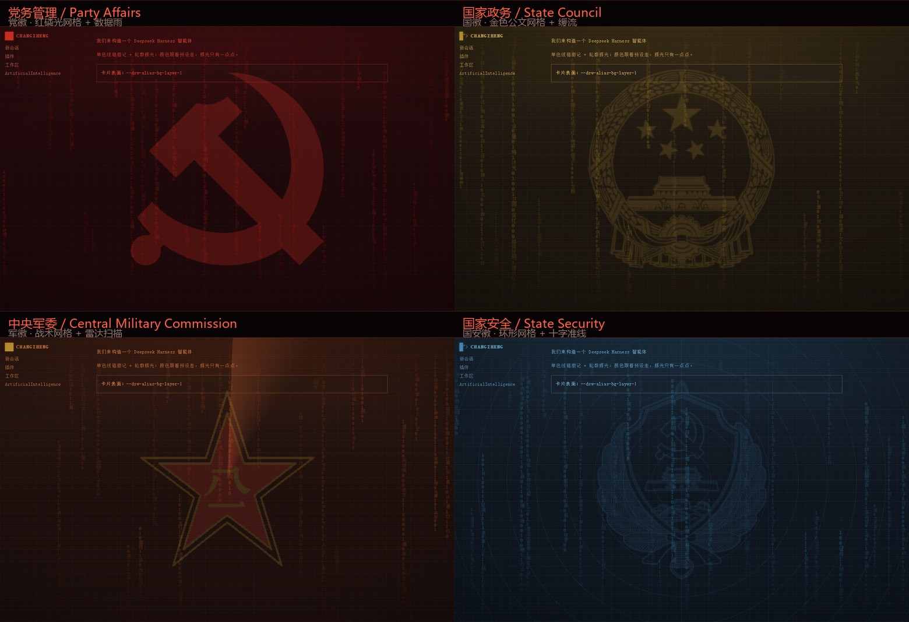

<p align="center"><a href="README.md">简体中文</a> · <b>English</b></p>

<h1 align="center">Long March Machine · dsh-theme-longmarch</h1>

> **Author**: [@Soviet-Dreadnaught](https://github.com/Soviet-Dreadnaught)
> **Repository**: https://github.com/Soviet-Dreadnaught/dsh-theme-longmarch
>
> Please keep these two lines when reposting, re-uploading or making videos about this project — the name is easily confused with other Long March themed plugins.




<sub>Motion preview (four department presets in rotation): red data rain, CRT scanlines + sweep band, the CMC radar sweep, and the emblem watermark.</sub>


> Turns the DeepSeek Harness Web GUI into the terminal of *The Fire Rises* (TFR) New Left 「Long March / Loji」 AI route:
> pure black with phosphor-red glyphs, red data rain, CRT scanlines — four department presets, each with its own emblem, palette and background pattern.

A purely visual plugin. It registers no tools, makes no network requests and never writes to the host DOM. It does exactly three things: remap the `--dsw-*` tokens, inject one CSS layer scoped entirely under `body[data-dsh-longmarch]`, and render a decoration layer plus a settings page inside the official slots.

## Contents

- [What it does](#what-it-does)
- [Installation](#installation)
- [The four department presets](#the-four-department-presets)
- [Settings](#settings)
- [Compatibility](#compatibility)
- [Implementation notes](#implementation-notes)
- [Troubleshooting](#troubleshooting)
- [Emblem sourcing](#emblem-sourcing)
- [Known limitations](#known-limitations)
- [License](#license)

## What it does

- **Palette**: the entire `--dsw-*` token set is remapped to the Long March route palette (pure black + phosphor red + signal green / amber / magenta)
- **Four department presets**: Party Affairs / State Council / Central Military Commission / State Security — each with its own emblem, palette and background pattern, switched with one click
- **Motion**: red binary rain (in the `shell.overlay` layer), CRT scanlines + slow sweep band, vignette, soft grain, a CHANGZHENG / CPUPF readout in the bottom-left corner
- **Settings page**: Settings → 「长征终端」 on the left: switch presets, toggle each effect, glow strength, scanline brightness, watermark emblem strength, glyph brightness (60–200%), reset (stored in browser localStorage)
- **Brand slot takeover**: the official DeepSeek wordmark in the top-left becomes `CHANGZHENG / CPUPF · status + cursor` (`sidebar.brand.name` / `sidebar.brand.mark`, priority −1 over the official one)
- **New-session headline takeover**: the whale and 「探索未至之境」 on the new-session page become the CPC emblem + `长征计划 · LONG MARCH` / `走向数字世界 · CPUPF` (can be turned off)
- **TUI square corners**: all radius tokens are zeroed; the composer card (`[data-composer-card]`) gets a 1px bright-red hard edge and a focus glow
- **Dark theme pinning**: registers a real `colorScheme: dark` theme and pins it, so the host writes `color-scheme: dark` / `data-ds-dark-theme` and other plugins switch their panels to dark accordingly
- **Light-token fallback**: overrides `--dsw-static-neutral-50/-100` and `--dsw-alias-file-diff-*` to remove the white blocks in deliverable / change cards

## Installation

### Option 1: drop it into the profile's node_modules (recommended, works on desktop)

```powershell
# 1. copy the package into the profile's node_modules
Copy-Item -Recurse -Force '.\dsh-theme-longmarch' "$env:DSH_PROFILE_DIR\node_modules\dsh-theme-longmarch"

# 2. keep this mount row at the end of the profile's cordis.patch.yml
#    - insert:
#        - id: dsh-theme-longmarch
#          name: 'dsh-theme-longmarch'

# 3. Ctrl+F5 to refresh (the host usually hot-swaps on bundle changes)
```

On Windows desktop the profile lives at `%USERPROFILE%\.dsh\profiles\desktop`.

To uninstall: delete `node_modules\dsh-theme-longmarch` and the three mount lines.

### Option 2: CLI

```bash
dsh plugin --profile desktop add ./dsh-theme-longmarch
```

> The desktop build may refuse a CLI install (it depends on whether that host version allows local packages). If it is refused, use Option 1.

## The four department presets



<sub>Static comparison of the four presets (Party / State / Military / Security). Emblem, palette and background pattern all switch together.</sub>

| Preset | id | Emblem | Form | Palette | Background pattern |
|---|---|---|---|---|---|
| Party Affairs | `party` | CPC emblem (hammer and sickle) | vector 24×24 | phosphor red | terminal grid + red data rain + CPC watermark |
| State Council | `state` | National emblem | single-colour line art 384×384 | gold / warm white | gold document grid + slow data stream + national emblem watermark |
| Central Military Commission | `cmc` | PLA emblem (gold star with red field + gold 八一) | bitmap 256×256 | orange-red / gold | tactical grid + radar sweep + PLA emblem watermark |
| State Security | `mss` | MSS emblem (shield + Great Wall + laurel) | single-colour line art 384×384 | steel blue / cyan | ring grid + crosshair + MSS emblem watermark |

The neutral layers (background / panels / borders) are derived proportionally from the preset's `label` colour, so the whole skin shifts tone when you switch presets.
Emblems are assembled in the `MARKS` table; the brand slot, the new-session hero and the background watermark all share the same definition.

## Settings

| Item | Description | Default |
|---|---|---|
| Department preset | pick one of four; switches emblem / palette / background pattern | Party Affairs |
| Data rain | red binary rain background layer | on |
| Scanlines | CRT scanlines + slow sweep band | on |
| Vignette | darken the edges of the screen | on |
| Corner readout | take over the top-left brand slot (CHANGZHENG / CPUPF / cursor) | on |
| Watermark emblem | strength of the department emblem in the background (preset baseline × multiplier, 0 = off) | 150% |
| Glow strength | text glow, scanlines and grain strength | 65 |
| Scanline brightness | strength of the CRT scanlines and sweep band | 50 |
| Glyph brightness | brightness of text and edges (60–200%); raise it if the page looks dim | 100 |
| Coexistence mode | auto yield / force takeover (see below) | auto yield |
| Take over brand slot | turn off to hand the official wordmark back untouched | on |
| Pin dark theme | register and pin the `colorScheme: dark` theme | on |
| Page-height fallback | seals page-level scrolling; a debugging aid (off by default) | off |
| Layout diagnostics | show innerH / rootH / frameH and the direct children of body in the bottom-right corner | off |
| Popup → current window | turn same-origin `window.open` with a hash into a hash change + reload in the current window | off |

All settings live in browser localStorage (key `dsh.longmarch.v1`) and do not travel between machines.

## Compatibility

### Ecosystem conventions

DSH skin / theme plugins recognise each other through **generic attributes on body** (`dsh-mpkg-wallpaper`'s `detectConflicts()` hard-codes the list:
`data-dsh-aurora` / `data-dsh-whale-song` / `data-dsh-skin` / `data-dsh-ui-skin` / `data-dsh-theme` / `data-skin`).
This plugin does two things at once:

- **Announces itself**: sets `data-dsh-skin` / `data-dsh-ui-skin` / `data-dsh-theme` = `longmarch` on `<body>`, so wallpaper / theme switchers step aside (it also has its own `data-dsh-longmarch`).
- **Detects others**: scans the signatures above, known theme / skin / wallpaper ids inside `[data-plugin]`, and third-party themes already registered with `ctx.theme`.

### Coexistence mode

| Mode | Behaviour |
|---|---|
| Auto yield (default) | when another skin / theme is detected, **does not register a theme and does not take the appearance preference**; keeps only its own CSS layer |
| Force takeover | ignores conflicts and always pins this theme |

### Portaled surfaces

`dialog` / `[role=dialog]` / `[role=menu]` / `[data-menu-material]` / `[data-radix-popper-content-wrapper]>*`
these roots are mounted on `body` by React and **carry their own copy of the tokens**; inheritance from body cannot reach them — so this theme re-declares the key tokens on them.
(The selector was borrowed from the most-downloaded skin, `@smalltailqwq/dsh-client-ui-skin-maid-atelier`.)

## Implementation notes

### Why the emblem is drawn in the overlay, not the background layer

Every full-screen decoration of this plugin (data rain, scanlines, emblems) is drawn inside the `shell.overlay` slot rather than in a `body::before` background layer. The reason is items 4 and 5 of [Troubleshooting](#troubleshooting):
**the host's structural full-screen surfaces (AppFrame → sidebar → conversation root → cards) are stacked one on top of another**, and a decoration painted below the content loses energy at every layer — a 12% emblem is already at zero by the second or third surface. The overlay is the decoration slot the host provides for skins, and it stays reliably visible.

The price is that decorations float above the content, so:

- the emblem baseline is 12–14% × 1.5 multiplier (adjustable in settings, 0 = off)
- data rain and scanlines are sparse / low-contrast patterns
- the bottom layer only carries the grid and the base gradient; it is not responsible for being "visible"

### Layer table inside the overlay

Every child of `.lm-fx` is `position:absolute`, so `z-index` takes effect directly:

| z-index | Content |
|---|---|
| 1 | Background patterns: the CMC rotating beam `.lm-radar`, the State Security rings `.lm-rings` + crosshair `.lm-cross` |
| 2 | Emblem `.lm-wm` |
| 3 | Data rain `.lm-rain` |
| 4 | Scanlines `.lm-scan` / sweep band `.lm-sweep` |
| 5 | Vignette `.lm-vig` |
| 6 / 7 | Corner readout `.lm-hud` / layout diagnostics `.lm-diag` |

Having the emblem above the beam and the rings is deliberate: the beam and rings are "background scanning", the emblem is a "foreground emblem". The `kids.push` order in the JSX follows the same table; the CSS simply pins the rule down.

### Theme registration

Layering tokens alone is not enough for other plugins to recognise that the host is dark. This plugin registers a real `colorScheme: dark` theme and calls `setTheme`, so the host writes `color-scheme` and `body[data-ds-dark-theme]`; a guard is attached to the `theme/change` event so the theme is pinned back if another plugin takes it over.

## Troubleshooting

| Symptom | Root cause | Fix |
|---|---|---|
| Deliverable / change cards render solid white | `dsh-client-ui-deliverables` points `--changes-fill / --deliverable-fill` at `--dsw-static-neutral-50`, and the diff area uses the light `--dsw-alias-file-diff-*-bg` | override both static neutral roots plus the 6 file-diff tokens (also written into an `!important` fallback block) |
| Third-party panels stay light grey on a dark skin | they decide the host theme from `data-ds-dark-theme` / `color-scheme` and fall back to white by default | register a real `colorScheme: dark` theme and pin it (settings: 「锁定暗色」) |
| A whole blank stretch appears when scrolling down | the position of a third-party floating panel comes from geometry it persisted itself; unrelated to the theme | the theme ships a height-chain fallback (settings: 「页面高度兜底」) plus 「布局诊断」 to locate it |
| The background layer does not show at all | ① once the host paints `html`, `body`'s `background-color` is no longer propagated to the canvas but painted as an ordinary box background on top of `body::before` (`z-index:-2`); ② the structural surfaces are filled with an opaque `--dsw-alias-bg-base` | set `body` to `background-color: transparent` (the base colour now comes from the bottom gradient of `::before`, plus a copy on `html` to avoid a white flash); set `--dsw-alias-bg-base` to `transparent`, make the sidebar fill 86% translucent, and explicitly clear `#root` / `*_frame` / `*_centerCol` / `*_sidebarCol` / `*_rightbarCol` / `*_root[data-phase]` |
| The watermark emblem is visible on only some presets | the full-screen surfaces stack up, and a 12% emblem inside `::before` decays at every layer until it hits zero at the second or third one | the emblem is drawn by the overlay instead (`shell.overlay` → `.lm-fx` → `.lm-wm`), on the same layer and of the same nature as the data rain |
| The emblem sits below the rotating beam / rings | nothing inside the overlay defined `z-index`, so only DOM order counted | pin the layer table (above) and keep the JSX order in sync with the CSS |

> How to diagnose: install Edge and run a **shell page that reproduces the host's real class names and tokens 1:1** (`msedge.exe --headless=new --screenshot`),
> then screenshot it before and after the change with the same CSS — the difference is immediately visible, no guessing required. For layering questions you can
> also swap the beam for a solid colour square and max out the emblem's opacity, then measure the centre pixel — far more reliable than eyeballing a screenshot.

## Emblem sourcing

| Emblem | Form | Source and processing |
|---|---|---|
| CPC emblem | vector 24×24 (145 points) | traced from the official standard artwork (4096px PNG released by People's Daily): alpha 0.5 marching-squares contour → Douglas-Peucker simplification → normalised to a 24×24 viewBox → one closed filled path |
| National emblem | single-colour line art 384×384 | ink extracted from the line art (`R - max(G,B)`) → cropped and normalised → 12-level alpha mask |
| PLA emblem | two-colour bitmap 256×256 | official line art → star body filled red, ink lines and 八一 filled gold |
| MSS emblem | single-colour line art 384×384 | same as above, ink extracted and flattened into a single-channel mask |

Each of the three forms is justified:

- **Vector** (CPC emblem): few strokes, never blurs at any scale, filled straight from the preset's `main` colour.
- **Single-colour line-art mask** (national / MSS emblem): the ink of the line art is extracted into an alpha-only PNG, then CSS uses `mask-image` to cut the shape and `currentColor` to paint it —
  so the colour follows the preset entirely (State Council = gold, State Security = steel blue) and changing it needs no re-render.
  A `.lm-glow` wrapper adds the contour glow: a tight 1px ring plus a faint 3.5px ring, both very subtle (the watermark variant switches to `vmin` units so it scales with size).
  > The glow has to live on the outer element — `filter` is applied before `mask`, so putting it on the same element gets clipped away by the mask.
- **Two-colour bitmap** (PLA emblem): the red-field gold star plus gold 八一 carries its own palette and is left alone.

Every asset is inlined as a data URI, so the plugin is always **a single file with zero dependencies** (it only `require('react')`, resolved through the platform module table).

The `main` / `deep` colour slots apply to the vector and single-colour mask emblems; the two-colour bitmap carries its own palette, so recolouring it means regenerating the PNG.

> Note: the CPC, national and PLA emblems are all official standard artwork; the MSS emblem is a traced line-art version, as the state security organs have never published a standard emblem.

### Ecosystem reference (scraped 2026-10)

| Plugin | npm downloads (last 30 days) | GitHub stars |
|---|---|---|
| dshmarket | 596,609 | – |
| dsh-better-sidebar | 241,407 | – |
| dsh-whale-widget | 186,009 | 4,853 |
| @smalltailqwq/dsh-client-ui-skin-maid-atelier | 39,269 | – |
| dsh-mpkg-wallpaper | 8,946 | – |
| dsh-theme-whalegirl | 2,805 | 1 |
| dsh-joi-channel-theme | 2,548 | – |

skin-maid (downloads) and whale-widget (stars) are the most installed themes in this category. This plugin keeps its own implementation but borrowed their **coexistence mechanics**
(generic attribute signatures, re-declaring portaled-surface tokens, yielding on conflict).

## Icon

The plugin icon comes from the Long March machine artwork shipped with *The Fire Rises* itself:
`gfx/interface/ideas/PRC/PRC_the_long_march_idea.png` (server rack + red star + hammer and sickle + binary strings — the very icon of the Long March national-focus line).

- `icon.png` — 68×68 true-colour PNG, palettised, cropped (2.4 KB)
- `icon@2x.png` — 136×136, for places that need a larger size
- `icon.svg` — a self-contained SVG wrapper around the same image (PNG embedded, one scalable file)

The DSH plugin manager reads **`meta.icon` from `package.json`** and uses it directly as an ``, so that field holds the data URI of this PNG (3.2 KB) —
a locally installed plugin has no marketplace image host, so inlining is the only option.

## Known limitations

- **The theme is global**: once enabled, every panel turns red/black. That is the point of a skin, not a bug.
- **Running alongside another skin plugin**, this one yields by default (CSS layer only, no appearance preference); switch to 「强制接管」 to force it.
- **Installation needs write access to the profile directory**: if the CLI refuses, the package has to be copied in by hand (see installation option 1).
- **A pure CSS layer does no pixel-level layout work**: the theme never moves or hides host controls, it only changes appearance.

## Author and provenance

- **Author**: [@Soviet-Dreadnaught](https://github.com/Soviet-Dreadnaught)
- **Repository**: https://github.com/Soviet-Dreadnaught/dsh-theme-longmarch
- Fan work; not affiliated with the authors of *The Fire Rises*, nor with DeepSeek
- Not the same project as other DSH 「Long March / Loji」-related plugins (for example the boot-animation kind) — please do not confuse them
- Please keep the author name and repository URL when reposting / re-uploading / making derivative videos

## License

MIT, see [LICENSE](./LICENSE). Version history in [CHANGELOG.md](./CHANGELOG.md).

*The Fire Rises* is a third-party mod for Hearts of Iron IV. This plugin is not affiliated with the mod authors or with DeepSeek; it only borrows the palette and imagery as fan work.
